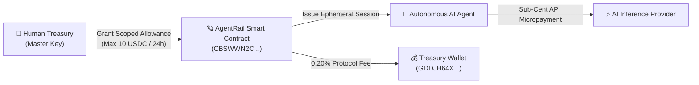

# SorobanAgents 🛰️🤖

> **Autonomous AI Agent Scoped-Allowance & Micro-Settlement Protocol on Stellar & Soroban.**

SorobanAgents builds decentralized economic infrastructure enabling autonomous AI agents, LLM toolchains (LangChain, Vercel AI SDK, ElizaOS, CrewAI), and multi-agent swarms to securely execute sub-cent micro-transactions, pay for inference APIs, and settle work on Stellar without exposing master private keys or requiring human popup clicks.

---

## 🏛️ Flagship Protocol: [AgentRail](https://github.com/SorobanAgents/agentrail)

The autonomous financial execution rail for AI agents on Soroban.

### 🌟 Core Architectural Pillars
- **🔐 Cryptographic Scoped Allowances:** Time-bounded, maximum-spend capped allowances stored in Soroban persistent storage with designated routing rules.
- **⚡ Sub-Cent Real-Time Streaming:** Sub-second payment calculations for pay-as-you-prompt inference fees in native Circle USDC.
- **🛡️ On-Chain Emergency Circuit Breaker:** Admin `pause()` and `unpause()` functions providing immediate freeze defense against agent compromise or anomalous spend loops.
- **🔄 Autonomous State TTL Keeper:** Continuous Soroban ledger monitoring and automated rent extension preventing state archival freeze.
- **💰 Built-In Protocol Fee Monetization:** On-chain 0.20% (20 bps) fee split automatically routing revenue to protocol treasury.

---

## 🪐 Verified On-Chain Deployment

The core AgentRail Soroban smart contract is compiled, hardened with 27 Rust invariant tests, and live on **Stellar Testnet**:

| Parameter | On-Chain Verification |
| :--- | :--- |
| **Network** | Stellar Testnet (`Test SDF Network ; September 2015`) |
| **Contract ID** | [`CBSWWN2CLUPW4VLYTGVJTT4XWXKF6LLJFQXEC7KK2KTAW3A26WIBZIN6`](https://stellar.expert/explorer/testnet/contract/CBSWWN2CLUPW4VLYTGVJTT4XWXKF6LLJFQXEC7KK2KTAW3A26WIBZIN6) |
| **Protocol Treasury Wallet** | [`GDDJH64X5VEXI7UWZMJA3YUG7ANYHKRRRFHLD2SF5OWEETNFBVYMRXZT`](https://stellar.expert/explorer/testnet/account/GDDJH64X5VEXI7UWZMJA3YUG7ANYHKRRRFHLD2SF5OWEETNFBVYMRXZT) |
| **Active Protocol Fee** | `20 bps` (0.20% per micro-spend transaction) |
| **Circuit Breaker Status** | `Active` (Operational / Unpaused) |
| **Test Coverage** | `51 Tests Passed` (27 Rust Invariant Tests + 24 TypeScript Vitest) |
| **WASM Hash (SHA-256)** | `cc753a83d462acbca4c5b95f95ec0eb82c445f8ea72f30ea7ef53cb07b0869dd` |

---

## 📋 Open Architecture Roadmap & Backlog

We maintain a fully categorized, transparent open-source engineering roadmap across 8 core pillars:

- 📦 **Flagship Repository:** [SorobanAgents/agentrail](https://github.com/SorobanAgents/agentrail)
- 🎯 **Active Issue Backlog:** [AgentRail Open Issues (60 Tasks)](https://github.com/SorobanAgents/agentrail/issues)
- 📜 **Contributing Guidelines:** [CONTRIBUTING.md](https://github.com/SorobanAgents/agentrail/blob/main/CONTRIBUTING.md)
- 🔒 **Security Policy & Threat Model:** [SECURITY.md](https://github.com/SorobanAgents/agentrail/blob/main/SECURITY.md)

---

## 🌐 Ecosystem & Standards Compliance
SorobanAgents protocols are built strictly compliant with Stellar Ecosystem Proposals:
- **SEP-01:** Machine-readable `stellar.toml` metadata discovery.
- **SEP-10:** Stellar Web Authentication via cryptographic challenges.
- **SEP-24:** Interactive deposit & withdrawal anchor standards.
- **SEP-38:** Request for Quote (RFQ) multi-currency conversion integration.
